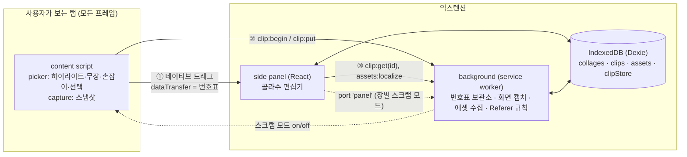
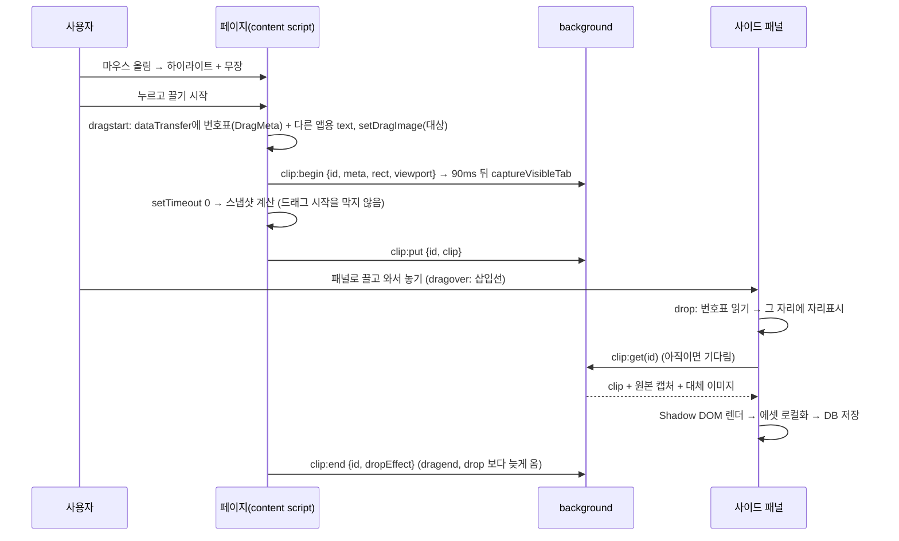

# Web Collage v2 리빌드 계획서

> 작성: 2026-10-07 · 대상 독자: **코드탭(Claude Code)에서 이 프로젝트를 실제로 진행할 AI**와 소유자(태섭님)
> 상태: 기술검증 통과(Linux), 착수 전 결정 사항 확인 대기

---

## 0. 이 문서를 읽는 AI에게

1. **읽는 순서**: [`../CLAUDE.md`](../CLAUDE.md) → [`CONTEXT.md`](CONTEXT.md) → **이 문서** → [`DECISIONS.md`](DECISIONS.md) → [`SPIKE_REPORT.md`](SPIKE_REPORT.md) → [`TEST_CASES.md`](TEST_CASES.md) → [`../spike/README.md`](../spike/README.md). [`LEGACY_ANALYSIS.md`](LEGACY_ANALYSIS.md)는 참고용.
2. **진행 방식**: [§10 마일스톤](#10-마일스톤)을 M0부터 순서대로. 각 마일스톤은 "작업 → 완료 기준 확인(테스트) → 소유자에게 보고"로 끝난다.
3. **시작 전에** [§13 착수 전 결정 사항](#13-착수-전-결정-사항)을 소유자에게 한 번에 묻는다(기본값을 제시하고 고르게 할 것).
4. **하지 말 것**: [DECISIONS 요약표](DECISIONS.md#요약표)에서 기각된 대안을 다시 제안하기 — 특히 **클릭으로 담기**. 드래그·스냅샷 변경을 진짜 마우스 E2E 없이 "완료" 처리하기. [테스트 전용 훅](TEST_CASES.md#3-절대-배포하면-안-되는-테스트-훅-must-not-ship)을 배포 빌드에 넣기.
5. **이미 검증된 참고 구현이 있다**: [`spike/extension/`](../spike/extension/). 동작이 애매하면 spike가 어떻게 했는지 먼저 본다. 코드의 `[G#]` 태그 주석이 함정 대응이다([SPIKE_REPORT §5](SPIKE_REPORT.md#5-발견해서-고친-함정-v2에-반드시-반영)). v2 코드에도 같은 태그를 단다.

---

## 1. 한 줄 요약

**아무 웹사이트에서나, 보이는 그대로의 조각을 마우스로 끌어 크롬 사이드 패널의 콜라주에 모으고, 원하는 형식으로 재구성·저장하는 크롬 익스텐션(MV3).**

```
┌────────────── 크롬 창 ──────────────────────────────────────┐
│ ┌──────── 사용자가 보는 실제 페이지 ───────┐ ┌─ 사이드 패널 ─┐ │
│ │                                         │ │ Web Collage   │ │
│ │   ┌ ⠿ article.card 580×565 ┐            │ │ ┌ Box 1 ─────┐│ │
│ │   │  (하이라이트된 요소)     │ ──끌기──▶ │ │ │ [조각][조각]││ │
│ │   └────────────────────────┘            │ │ └────────────┘│ │
│ │                                         │ │ ┌ Box 2 ─────┐│ │
│ │                                         │ │ │ ─ 삽입선 ─  ││ │
│ └─────────────────────────────────────────┘ └───────────────┘ │
└─────────────────────────────────────────────────────────────┘
```

## 2. 목표와 성공 기준

### 제품 목표
- 정보가 흩어진 웹페이지들에서 **필요한 조각만 쉽게 끌어 모아**, 가독성 좋은 나만의 문서로 재구성한다. (v1의 출발점 계승)
- **상용 사이트에서 실제로 동작**한다. (v1이 실패한 지점)
- 가져온 조각은 **원본과 같은 모양**이고, 원본 사이트가 바뀌거나 사라져도 그대로 남는다.

### MVP 성공 기준 (M0~M3 완료 시 모두 만족)
| # | 기준 | 측정 |
|---|---|---|
| S1 | 로컬 테스트 사이트의 모든 케이스([TEST_CASES §1](TEST_CASES.md#1-케이스별-합격-기준)) 통과. 실제 사이트 회귀 목록([SPIKE_REPORT §4](SPIKE_REPORT.md#4-실제-사이트-최종-빌드-기준))은 **테스트 환경에서 접근 가능한 곳** 기준(나무위키처럼 환경이 차단된 곳 제외) | `run_local.sh` 종료 코드 0, `real.py` |
| S2 | 스크랩한 조각이 원본과 시각적으로 같다 | 원본 캡처 vs 조각 렌더 픽셀 비교(M1에서 도구 제작, 기준값은 측정 후 소유자와 확정) |
| S3 | 드롭 → **첫 렌더 200ms 이하**(요소 1,000개 이하), 그리고 스냅샷 시간 ≤ 300ms(사람이 휙 끌어 놓는 최소 시간 수준) | `dropToVisibleMs`(조각 HTML 삽입 직후 시각), `stats.snapshotMs` |
| S4 | 브라우저를 껐다 켜도, **오프라인이어도** 콜라주(이미지·폰트 포함)가 그대로 | E2E(같은 프로필로 재시작 + 네트워크 차단, M3에서 하네스 옵션 추가) |
| S5 | **Windows 크롬 실물**에서 동작 | 소유자 확인(체크리스트는 M0) |
| S6 | 드래그 방지 사이트, iframe 안, Shadow DOM, 편집 영역(손잡이)에서도 동작 | E2E |

## 3. 범위

| 구분 | 내용 |
|---|---|
| **MVP (M0~M3)** | 하이라이트·무장·손잡이·텍스트 선택 드래그, 스냅샷(캡처 엔진), 사이드 패널 편집기(Box & Block, 삽입 위치, 순서 바꾸기, 중첩 박스, 가로/세로), 로컬 저장(IndexedDB), 이미지·폰트 로컬화, 내보내기(HTML·Markdown·인쇄/PDF) |
| **이후 (M4~M7)** | UX 다듬기·테마·온보딩·다국어, 조각 안 텍스트 편집·이미지 크기·메모·드로잉 주석, 읽기 전용 공유 링크, 실시간 협업(Yjs), 웹스토어 출시 |
| **하지 않음** | ❌ 클릭으로 담기(주 방식) · ❌ 페이지 HTML 다시 받아오기 · ❌ 서버 필수 구조 · 모바일 · Firefox(초기, 나중에 `sidebar_action` 검토) |

## 4. 사용자 흐름

1. 툴바 아이콘 또는 **Alt+Shift+K**로 사이드 패널을 연다. → 그 창에서 **스크랩 모드**(패널 상단 스위치로 끄고 켤 수 있음, M2).
2. 페이지에서 마우스를 올리면 그 요소가 **빨간 테두리 + 라벨(⠿ 태그·크기)**로 하이라이트된다.
3. 원하는 단위를 고른다.
   - 그냥 그 요소를 **잡고 끈다**. (가장 기본)
   - 더 큰 덩어리가 필요하면 **Alt + 휠 위로**(부모로 넓히기), 아래로(되돌리기).
   - 코드 에디터처럼 잡히지 않는 영역은 **라벨(⠿ 손잡이)을 잡고** 끈다.
   - 글 일부만 필요하면 **Alt를 누른 채 드래그**로 선택 → 선택 부분을 잡고 끈다.
4. 패널의 박스 위로 가져가면 **삽입선**이 보인다. 놓으면 그 자리에 즉시 자리표시가 생기고, 수십 ms 안에 원본 모양의 조각이 나타난다.
5. 패널에서 정리한다: 새 박스, 박스 중첩, 가로/세로 정렬, 블록 순서 바꾸기(블록 머리 끌기), 삭제, 원본 비교, 출처 열기. 모든 변경은 **자동 저장**.
6. 필요하면 내보낸다: 단일 HTML 파일, Markdown, 인쇄/PDF.

## 5. 아키텍처



| 모듈 | 책임 | 비고 |
|---|---|---|
| **content script** | 스크랩 모드일 때 하이라이트·무장, 드래그 시작(번호표), 스냅샷 계산 후 전달 | **프레임워크 없이** 바닐라 TS. 모든 페이지·모든 프레임에 `document_start` 주입. 스크랩 모드가 꺼져 있으면 리스너에서 즉시 반환하고, **non-passive 리스너(특히 wheel)는 등록하지 않는다**(G20) |
| **background** | 조각 보관(번호표 ↔ 스냅샷), `captureVisibleTab`으로 원본 캡처·대체 이미지, 이미지·폰트 받아서 **에셋 Blob 저장**(Referer 규칙), 창별 패널 연결 관리 | MV3 service worker: 잠들 수 있으므로 상태는 IndexedDB에(G18) |
| **side panel** | 드롭 받기·삽입 위치, Box & Block 편집기, 조각 렌더(Shadow DOM), 콜라주 저장·내보내기 | React + TS |
| **DB** | 콜라주 문서, 조각, 에셋(Blob), 진행 중 조각 보관소 | Dexie, 스키마 버전 관리. 패널과 background 모두 접근(같은 익스텐션 origin) |

## 6. 핵심 메커니즘

### 6.1 picker (하이라이트·무장·손잡이·선택)
spike `content.js`의 동작을 그대로 따른다. 규칙:
- 하이라이트는 **페이지 레이아웃·스타일에 영향을 주지 않는 오버레이**로 그린다(closed Shadow DOM, `position:fixed`, 최상위 z-index). 다만 페이지 DOM 을 전혀 안 건드리는 것은 아니다: ① 오버레이 host 요소를 `<html>`에 붙이고 ② UA 기본값 계산용 숨김 iframe 을 붙이며 ③ 무장한 요소에 `draggable`·인라인 스타일을 잠시 단다. 페이지의 MutationObserver 가 반응할 수 있다는 점을 기억할 것.
- **무장**: 하이라이트 대상에 `draggable="true"` + 인라인 `-webkit-user-drag: element !important`. 대상이 바뀌면 원래 값으로 되돌린다(`disarm`).
- **누르고 있는 동안 대상 고정**(G1). Alt는 **마우스 이벤트의 `altKey`**로(G4). **선택 영역과 겹치는 요소는 무장하지 않음**(G5).
- `pointerdown`/`mousedown`/`dragstart`를 `window` capture 단계에서 `stopImmediatePropagation`(기본 동작은 막지 않음) → 사이트의 드래그 방지 무력화(G10).
  ⚠️ 부작용(R3): 스크랩 모드에서 무장된 요소의 mousedown 이 페이지에 전달되지 않고 click 도 막혀서 **링크·버튼·메뉴가 동작하지 않는다.** M0는 spike 그대로 두고, M2에서 소유자 결정(Q9)에 따라 정책을 바꾼다.
- **라벨 손잡이**: 라벨 자체가 draggable. 손잡이 드래그 시작 시 라벨을 바로 숨기지 말 것(G3).
- **Alt + 휠**: 부모로 넓히기(Shadow DOM 경계는 host로 올라감), 아래로 되돌리기. 휠 리스너는 스크랩 모드일 때만 등록(G20).
- 제품에서 추가: 라벨에 **경로 브레드크럼**(예: `main › article › p`)을 보여주고 클릭으로 단계 선택(M4).

### 6.2 드래그 프로토콜 (번호표)



**dataTransfer 내용**
| 타입 | 값 | 용도 |
|---|---|---|
| `application/x-web-collage` | `DragMeta` JSON ([§8](#8-메시지-프로토콜)) | 우리 패널이 읽는 번호표 |
| `text/plain` | 대상의 보이는 텍스트 | 다른 앱에 놓을 때 |
| `text/html` | 요소: 원본 `outerHTML` / 선택: 크롬 기본값 유지 | 다른 앱에 놓을 때 |

- ⚠️ R8: spike는 `text/plain`(`innerText`)과 `text/html`(`outerHTML`)을 `dragstart` 안에서 **동기로** 만든다. 큰 요소에서는 드래그 시작이 늦어질 수 있으므로 v2는 **상한**을 둔다(예: `textContent` 앞 2,000자, `outerHTML`은 1MB 넘으면 생략). 무거운 것은 전부 스냅샷 쪽으로.
- **폴백(M0에서 구현)**: 다른 OS에서 커스텀 타입이 안 넘어오는 경우 대비. background 가 `clip:begin`~`clip:end` 사이의 **진행 중 드래그**를 기억하고(drop 은 dragend 보다 먼저 일어나므로 drop 시점엔 진행 중), 패널은 drop 에서 커스텀 타입이 없으면 `clip:current`로 그 드래그를 받는다. 30초가 지났거나 진행 중 드래그가 없으면 "외부 드롭"으로 처리. 이미지 드래그처럼 `text/plain`이 없는 경우에도 동작한다. E2E 빌드에는 커스텀 타입을 일부러 빼는 스위치를 둬서 이 폴백을 실제로 테스트한다.

### 6.3 스냅샷 알고리즘 (capture)
spike `snapshot()`의 순서를 따른다.
1. 비활성 문서(`document.implementation.createHTMLDocument('')`)에 복제본을 만든다(커스텀 엘리먼트 코드 실행 방지, G15).
2. 요소마다 `getComputedStyle` → **실제 CSS 속성 목록(~380개, 깨끗한 문서에서 한 번 추출)**만 순회(G7).
   - 상속 속성: 부모 계산값과 같으면 생략 (루트는 전부 기록).
   - 비상속 속성: UA 기본값(숨김 iframe에서 태그별 계산, 캐시)과 같으면 생략.
   - 테두리 스타일이 있으면 두께를 항상 함께(G6). 안 보이는 테두리·윤곽선 색은 생략.
   - 블록 요소는 `width` 고정 + `min-height`, 대체 요소는 width/height 고정.
   - `overflow: auto|scroll` → `hidden`(G8). 자손의 `fixed` → `absolute`, `sticky` → `relative`.
3. `::before/::after`는 `[data-wcid="n"]::before{…}` 규칙으로 `css`에 모은다.
4. 자식: Shadow DOM은 펼친다(closed는 `chrome.dom.openOrClosedShadowRoot`, `<slot>`은 할당 노드로, G14). `display:none`·script·style·SVG 애니메이션(`set`/`animate*`) 등은 건너뛴다.
5. 특수 요소: canvas → `toDataURL`(오염되면 스크린샷 대체), iframe/embed/object → 스크린샷 대체, video → poster(없으면 스크린샷), img → `currentSrc`(+`data-src` 등 지연 로딩), 폼 → 현재 값(비밀번호·파일 제외).
6. 속성 복사: **HTML 은 허용 목록**만, SVG 는 현재 거부 목록(`on*`·`style`·`class`·`data-wc*` 제외 전부) → **M1에서 SVG도 허용 목록으로**. URL 은 **정규화한 뒤 프로토콜로 판단**(G21): href 는 http(s)만, src 는 http(s)와 `data:image/*`만. 링크는 새 탭.
7. SVG `<use href="#id">` 참조 심볼을 `defs`로 함께 담는다.
8. 루트 보정: `position: relative`, margin 0, transform·float 제거.
9. 폰트: 사용 font-family의 `@font-face`를 수집(접근 가능한 시트는 CSSOM, 교차 출처 시트는 background가 받아 파싱).
10. 결과(`RawClip`, [§8](#8-메시지-프로토콜)): `{html, css, defs, width, height, families, fontFaces, crossOriginSheets, imageUrls, fallbacks, warnings, stats}` (+content script 가 `meta` 추가, 실패 시 `{error}`).
- ⚠️ R6: 스냅샷은 버튼을 누른 채로(드래그 중) 뜨므로 `:hover`·`:active` 스타일이 **박제**될 수 있다(카드가 떠 있는 모양, 링크 밑줄). refShot 도 같은 상태라 픽셀 비교로는 안 잡힌다 → M1에서 조사.

### 6.4 패널 렌더링과 정화(sanitize) 정책
- 블록마다 `attachShadow({mode:'open'})`, host는 `all: initial`. `css`와 `defs`를 같이 넣는다.
- `@font-face`는 **패널 `document.head`**에 주입(G13). family 이름 충돌은 접두어로 해결(M1).
- 패널 폭보다 넓으면 CSS `zoom`으로 축소(기본 "맞춤"). 블록별 표시 방식: `fit`(축소) / `original`(가로 스크롤) / `reflow`(텍스트 위주 조각을 폭에 맞춰 다시 흐르게, M1 실험).
- **정화 정책(D17)**:
  - **우리 스냅샷**(content script 의 허용 목록 직렬화 결과)은 패널에서 그대로 렌더한다. 대신 직렬화기를 보안 경계로 취급해 단위 테스트로 지킨다(G21 같은 우회 사례 포함).
  - **외부 출처 HTML**은 반드시 DOMPurify 를 거친다: 우리 번호표가 없는 외부 드롭(`text/html`), 가져오기(import), 공유받은 콘텐츠(M6).
  - **내보낸 HTML**(M3)은 `file://`에서 CSP 없이 열리므로, 문서에 `<meta http-equiv="Content-Security-Policy" content="script-src 'none'">`를 넣는다.

### 6.5 에셋 파이프라인
- 이미지(img·`url()`·SVG image·poster), 폰트 파일, 원본 캡처(refShot), 대체 이미지 → **background가 받아 Blob으로 IndexedDB 에 저장**, 패널은 object URL로 표시.
- 받는 순서(M1·M3): ① 일반 요청(`credentials:'omit'`) → ② 실패하면 `declarativeNetRequest` 세션 규칙으로 Referer 를 원래 페이지로 설정해 재시도(D7) → ③ 로그인 이미지(R7)는 원본 페이지 쪽에서 얻기(같은 출처면 content script 의 fetch/canvas) → ④ 마지막으로 `credentials:'include'` 시도.
- Referer 규칙: 규칙 id 는 재시작해도 겹치지 않게(저장된 카운터 또는 기존 세션 규칙 조회 후 할당), 같은 host 에 대한 요청은 직렬화, 끝나면 즉시 제거.
- 내용 해시(SHA-256)로 중복 제거, 참조가 없어진 에셋은 정리(GC).
- ⚠️ R9: 이미지 드래그엔 `Files`가 남아 페이지의 업로드 드롭존이 반응할 수 있다 → M1에서 조사(대안 탐색 후 소유자에게 보고).

### 6.6 스크랩 모드 상태
- spike: 패널이 `runtime.connect({name:'panel'})` → `storage.local.scrapEnabled = true`, 포트가 모두 끊기면 false. content script는 이 값을 구독. **문제(R3)**: 값이 하나라서 패널이 없는 다른 창도 스크랩 모드가 된다.
- v2(M2): **창 단위**로 관리한다. 패널은 연결할 때 자기 `windowId`를 알리고, background 는 "패널이 열린 창 목록"을 가진다. content script 는 background 에 "내 창(sender.tab.windowId)이 스크랩 모드인지" 묻고, 변경은 해당 창의 탭들에 메시지로 알린다(탭이 다른 창으로 옮겨지면 `tabs.onAttached`로 갱신).
- 패널은 20초마다 ping 하고, 포트가 끊기면 **재연결**한다(R4).
- 설치·업데이트 직후 이미 열린 탭에는 content script 가 없다(R4) → `scripting.executeScript`로 주입하거나 "탭을 새로고침하세요" 안내. 업데이트 후 남은 옛 content script 는 `chrome.runtime.id`가 사라진 것을 감지하면 리스너를 모두 떼고 무장을 해제한다.

## 7. 데이터 모델

```ts
// src/shared/types.ts — 저장 모델 (IndexedDB)
export type ID = string; // crypto.randomUUID()

/** 콜라주 문서 하나 = 트리 하나 (작으므로 통째로 저장 → Undo/협업(Yjs) 전환이 쉬움) */
export interface CollageDoc {
  id: ID;
  title: string;
  theme: ThemeId;                 // 'light' | 'dark' | 'sepia' | ... (v1 테마 계승)
  root: BoxNode;                  // 최상위 박스 (세로 방향)
  createdAt: number;
  updatedAt: number;
  schemaVersion: 1;
}

/** v1의 Box: 블록과 다른 박스를 담는 바구니. 가로/세로 정렬 */
export interface BoxNode {
  kind: 'box';
  id: ID;
  title?: string;
  direction: 'column' | 'row';
  children: Array<BoxNode | BlockNode>;   // 중첩 최대 3단계
}

/** v1의 Block: 개별 조각 */
export interface BlockNode {
  kind: 'block';
  id: ID;
  type: 'clip' | 'note';          // note 는 M5
  clipId?: ID;
  note?: string;
  display: 'fit' | 'original' | 'reflow';
}

/** 스크랩한 조각 (크므로 별도 테이블) */
export interface Clip {
  id: ID;                         // 드래그 번호표 id 를 그대로 사용
  kind: 'element' | 'selection';
  source: { url: string; title: string; frameUrl?: string; capturedAt: number; via: 'native' | 'handle' };
  html: string;                   // 스타일을 인라인으로 굳힌 HTML (허용 목록 직렬화 결과)
  css: string;                    // 가상요소 규칙
  defs: string;                   // SVG 심볼
  width: number;                  // 원본 CSS px
  height: number;
  fontFaces: string[];            // url() 은 저장 후 'wc-asset:<assetId>' 로 치환
  assetMap: Record<string, ID>;   // 원본 URL → Asset.id
  refShotAssetId?: ID;            // 원본 화면 캡처 (비교용)
  fallbacks: Array<{ n: number; reason: string; assetId?: ID }>;
  text: string;                   // 검색·미리보기용 평문
  stats: { nodes: number; htmlBytes: number; snapshotMs: number };
}

export interface Asset {
  id: ID;                         // 내용 SHA-256 (중복 제거)
  mime: string;
  bytes: number;
  blob: Blob;
  sourceUrl?: string;
}
```

Dexie 스키마(초안): `collages: 'id, updatedAt'`, `clips: 'id, source.url'`, `assets: 'id'`, `clipStore: 'id, createdAt'`(background 의 진행 중 조각 보관소). 렌더 시 `wc-asset:<id>` → `URL.createObjectURL(blob)`로 바꿔 끼운다.

## 8. 메시지 프로토콜

```ts
// src/shared/protocol.ts
export const WC_MIME = 'application/x-web-collage';   // 페이지 → 패널 번호표
export const WC_MOVE_MIME = 'application/x-wc-move';  // 패널 안 블록 이동

export interface DragMeta {
  v: 1; id: ID; kind: 'element' | 'selection'; via: 'native' | 'handle';
  url: string; title: string; isTop: boolean; tag: string; w: number; h: number; startedAt: number;
  nativeTypes: string[]; originNodeType: number; htmlPayloadBytes?: number;
}
export interface Rect { x: number; y: number; w: number; h: number }

/** content script 가 만든 스냅샷 결과 */
export interface RawClip {
  html: string; css: string; defs: string; width: number; height: number;
  families: string[]; fontFaces: string[]; crossOriginSheets: string[];
  imageUrls: string[];
  fallbacks: Array<{ n: number; reason: string; rect: Rect; dataUrl?: string }>;  // dataUrl 은 background 가 채움
  warnings: string[];
  stats: { nodes: number; props: number; htmlBytes: number; pseudoRules: number; snapshotMs: number; walkMs?: number; fontScanMs?: number; captureMs?: number; finalizeMs?: number };
  meta: DragMeta;
  refShot?: string;               // background 가 채움 (원본 화면 크롭)
  finalizeError?: string;
}
export type ClipResult = RawClip | { error: string };

/** content → background */
export type ContentMsg =
  | { type: 'clip:begin'; id: ID; meta: DragMeta; rect: Rect; viewport: { w: number; h: number } }
  | { type: 'clip:put'; id: ID; clip: RawClip | { error: string; meta: DragMeta } }
  | { type: 'clip:end'; id: ID; dropEffect: string | null }
  | { type: 'panel:open' };                                  // 우리 오버레이 UI 버튼에서만 (사용자 제스처 필요)

/** panel → background (응답 있음) */
export type PanelReq =
  | { type: 'clip:get'; id: ID; timeoutMs?: number }         // → ClipResult
  | { type: 'clip:current' }                                 // → ClipResult | null   (커스텀 MIME 미도착 폴백, §6.2)
  | { type: 'clip:end-info'; id: ID }                        // → { dropEffect, at } | null
  | { type: 'assets:localize'; urls: string[]; referer: string }
      // → Record<url, { ok: boolean; assetId?: ID; status?: number; via?: 'direct' | 'referer' | 'page' | 'credentials'; error?: string }>
/** panel ↔ background: Port 'panel' — 연결 시 { windowId } 전달, 20초 ping, 끊기면 재연결 */
/** background → content: 스크랩 모드 on/off (창 단위, §6.6) */
```

**spike 이름 → v2 이름**
| spike | v2 | 비고 |
|---|---|---|
| `clip:begin` / `clip:put` / `clip:end` / `clip:get` / `clip:end-info` | 같음 | |
| `localize` (응답: `{url: {status, dataUrl, bytes, ms, via, firstStatus, firstError, tooBig?}}`) | `assets:localize` (응답: `assetId` 중심) | v2는 data URL 대신 Blob 저장 |
| `open-panel` (페이지 `postMessage` 훅) | `panel:open` (우리 UI에서만) | 훅은 테스트 빌드 전용 |
| (없음) | `clip:current` | 폴백 신설 |
| 포트 `panel` + `storage.local.scrapEnabled` | 포트 `panel`(+windowId) + 창 단위 메시지 | R3 |

- 메시지는 타입 가드로 검증한다. 크기·형식이 이상한 메시지는 버린다.
- 진행 중 조각 보관소는 **IndexedDB(`clipStore`)**에 둔다(`chrome.storage.session`은 전체 10MB 제한이라 큰 조각 하나로 넘칠 수 있음, R5). 10분 지난 미사용 항목은 정리.

## 9. 기술 스택과 레포 구조

| 영역 | 선택 (D13, 🟡 착수 시 최신 확인) |
|---|---|
| 익스텐션 | **WXT** (Vite, MV3, 사이드 패널 엔트리포인트) |
| 언어 | TypeScript strict |
| 패널 | React + Zustand(+immer 패치로 Undo/Redo) |
| content script | 바닐라 TS (번들 작게) |
| 저장 | Dexie |
| 정화 | DOMPurify (외부 출처 HTML) |
| 테스트 | Vitest(순수 로직), Python E2E 하네스(드래그·스냅샷), 필요시 Playwright(비드래그 통합) |
| 패키지 | pnpm |

```
web-collage-v2/
├─ CLAUDE.md
├─ docs/                     # 이 패키지의 문서 (결정·함정 갱신)
├─ spike/                    # 참고 구현 + 진짜 마우스 하네스 (수정하지 말고 참고)
├─ wxt.config.ts             # manifest 설정
├─ entrypoints/
│  ├─ background.ts
│  ├─ content.ts             # matches <all_urls>, runAt document_start, allFrames, matchAboutBlank
│  └─ sidepanel/ (index.html, main.tsx)
├─ src/
│  ├─ shared/                # types.ts, protocol.ts, constants.ts
│  ├─ picker/                # overlay.ts, arming.ts, selection.ts, events.ts
│  ├─ capture/               # snapshot.ts, styles.ts, defaults.ts, shadow.ts, media.ts, fonts.ts, sanitize.ts
│  ├─ bg/                    # clip-store.ts, screenshot.ts, assets.ts, referer-rule.ts, panel-port.ts
│  ├─ panel/                 # App.tsx, board/, block/, dnd/, store/
│  ├─ db/                    # dexie.ts, migrations.ts
│  ├─ export/                # html.ts, markdown.ts, print.ts
│  └─ testhooks/             # E2E 빌드에서만 포함 (TEST_CASES §3)
├─ tests/                    # Vitest
├─ e2e/                      # spike/harness 를 "복사"해 v2 빌드용으로 맞춘 것
└─ testsite/                 # spike/testsite 복사 + 추가 케이스
```

manifest 핵심(값은 spike와 동일): permissions `sidePanel`, `storage`, `declarativeNetRequestWithHostAccess` (+ M2 `scripting`, M3 `unlimitedStorage` 검토), host_permissions `<all_urls>`, `commands._execute_action` = Alt+Shift+K, `minimum_chrome_version` 116, **name `Web Collage`, version `2.0.0` 이상**(웹스토어 기존 항목 업데이트는 v1 공개 버전보다 높아야 함).

## 10. 마일스톤

> 표기: ☐ 작업 · ✅ 완료 기준 · 👤 소유자가 할 일. 각 마일스톤 = 브랜치 1개 + PR(완료 기준 체크 결과·테스트 출력 첨부).

### M0. 프로젝트 세팅과 기준선
**목표**: spike와 **똑같이 동작하는** v2 뼈대 + 자동 E2E + 폴백. (새 기능 없음)
- ☐ **환경 점검**(변경 없이): node·pnpm, Chromium 경로·버전, Xvfb·xdotool·ImageMagick `import`·curl·python 패키지, 프록시·외부망 여부. WXT·React·Dexie·DOMPurify 최신 버전 확인.
- ☐ **기준선 먼저**: 손대기 전에 `bash spike/harness/run_local.sh`를 그대로 돌려 결과(종료 코드·`spike/out/reports.jsonl`·스크린샷)를 비교 기준으로 남긴다.
- ☐ 새 레포 구조 생성(WXT + React + TS strict + pnpm), [§9](#9-기술-스택과-레포-구조) 구조로. `.gitignore`에 `spike/out/`, `out/`, `.output/`, `node_modules/`, `__pycache__/`.
- ☐ manifest 를 spike와 같은 값으로(`wxt.config.ts`), 빌드된 `.output/chrome-mv3/manifest.json`을 `spike/extension/manifest.json`과 비교.
- ☐ `src/shared/protocol.ts`부터 작성([§8](#8-메시지-프로토콜)), 그다음 spike 로직을 TS 모듈로 이식: picker, capture, background, 최소 패널(박스 2개 + 새 박스 + 삽입선 + 순서 바꾸기 + 검증 로그). **동작과 `[G#]` 주석 그대로.**
- ☐ `clip:current` 폴백 + E2E 빌드에서 커스텀 MIME 을 빼는 스위치([§6.2](#62-드래그-프로토콜-번호표)), 그 스위치로 폴백 E2E 케이스 추가.
- ☐ `dragstart` 동기 작업 상한(R8).
- ☐ **테스트 훅은 E2E 빌드에서만**(D16): [TEST_CASES §3](TEST_CASES.md#3-절대-배포하면-안-되는-테스트-훅-must-not-ship)의 훅 전부(content script 의 `data-wc-target`·`data-wc-pad`·`postMessage` 패널 열기, 패널의 결과 보고·`__wcResults`). E2E 빌드는 별도 출력 폴더로. **배포 빌드에서 훅 문자열을 grep 해 하나라도 있으면 실패**하는 검사 추가.
- ☐ E2E: `spike/harness`·`spike/testsite`를 `e2e/`·`testsite/`로 **복사**해 v2 E2E 빌드를 로드하게(`EXT=`). [하네스 계약](TEST_CASES.md#2-하네스-계약-v2-패널빌드가-지켜야-하는-것)을 지키거나 셀렉터를 `data-testid`로 바꿈. `pnpm e2e` = E2E 빌드 + 전체 실행, 실패 시 종료 코드 1.
- ☐ Vitest 기본 설정 + 순수 함수 테스트(URL 절대화·`safeUrl`, font-family 파싱, `@font-face` 추출). 필요하면 spike 에서 순수 함수로 떼어낸다.
- ☐ `CLAUDE.md`의 명령어 섹션 갱신.
- 👤 **집 Windows 크롬 확인(10분)** — 아래 체크리스트.
- ✅ `pnpm build`·`pnpm test` 통과, 배포 빌드 훅 검사 통과.
- ✅ `pnpm e2e`가 [TEST_CASES §1](TEST_CASES.md#1-케이스별-합격-기준) 로컬 케이스 전부 PASS(종료 코드 0), 폴백 케이스 PASS, CORE 드롭→표시 ≤ 200ms.
- ✅ 소유자의 Windows 결과를 `docs/SPIKE_REPORT.md`에 기록.
- **Windows 결과를 기다리는 동안**: M0 PR 은 머지해도 되고 M1 을 시작해도 된다. 결과가 **실패**면 M1 을 멈추고 원인 분석 → 소유자와 플랜 B(페이지 위 편집기, D3) 여부를 논의한다.

**👤 Windows 체크리스트 (소유자용)**
1. `chrome://extensions` → 개발자 모드 → "압축해제된 확장 프로그램을 로드합니다" → `spike/extension` 폴더 선택.
2. **로드하기 전부터 열려 있던 탭은 새로고침**한다(새로 로드한 익스텐션은 기존 탭에 안 들어감).
3. Alt+Shift+K 로 패널 열기. 안 되면 툴바 퍼즐 아이콘에서 고정 후 클릭, 또는 `chrome://extensions/shortcuts`에서 단축키 지정. (Alt+Shift 가 입력 언어 전환과 겹치는지도 봐 주세요.)
4. 네이버·유튜브에서 카드를 그냥 잡아 패널 박스에 놓기.
5. 패널 아래 **"검증 로그"**를 펼쳐 **"드롭 OK"**(번호표 도착)인지 **"외부 드롭"**(번호표 미도착)인지 확인 ← 이게 확인하려는 핵심.
6. Alt+휠로 부모 넓히기, 라벨(⠿) 손잡이로 끌기(예: MDN 라이브 예제), Alt 누른 채 텍스트 일부 선택 후 끌기.
7. 패널 화면 스크린샷을 AI에게 전달.

### M1. 캡처 엔진 완성도
**목표**: "원본과 같은 모양"을 측정 가능하게 만들고 알려진 한계를 해결.
- ☐ **충실도 측정 도구**: refShot(원본 캡처)과 패널 조각 렌더(1:1 배율, 같은 폭)를 픽셀 비교(pixelmatch 등)해 차이 비율을 보고. 익스텐션 내부 테스트 페이지(`fidelity.html`)에서 조각을 원본 폭으로 렌더.
- ☐ **로컬 testsite 케이스 추가**([TEST_CASES §4](TEST_CASES.md#4-케이스-추가-규칙)): Tailwind식 테두리(G6), 스크롤 컨테이너(G8), fixed·sticky 자식, `:hover` 스타일, 업로드 드롭존, quirks 모드, CORS 헤더 없는 교차 출처 웹폰트(서버에 별도 경로), 절대 위치 레이아웃, 지연 로딩 이미지, `image-set()`, transform, 중첩 flex/grid, 다크 배경, 아이콘 폰트.
- ☐ **절대 위치 보정**: 포함 블록이 루트 밖인 absolute 자손 → 루트 기준 좌표로 재계산(네이버 블로그 목록 사례).
- ☐ **폰트 로컬화**: 폰트 파일을 background가 받아 Blob 저장, family 이름에 접두어(`wc-<hash>-원래이름`)를 붙이고 조각 CSS의 font-family도 함께 치환. CORS 실패 사례(GitHub) 해결.
- ☐ **iframe 내용**: 교차 출처 iframe은 그 프레임의 content script에게 스냅샷을 요청(frameId 매핑; 필요시 `webNavigation` 권한 검토), 실패 시 스크린샷. iframe 안에서 시작한 드래그의 스크린샷 좌표 변환(최상위 프레임과 협력).
- ☐ **영상**: poster → 현재 프레임(가능하면) → 스크린샷 → 출처 링크 카드.
- ☐ **성능**: 요소 처리를 시간 조각(예: 8~12ms)으로 나눠 페이지 멈춤 방지. 그 사이 DOM 변경은 MutationObserver 로 감지해 다시 뜨거나 중단(R12). 태그별 기본값 캐시 유지, 2만 개 초과 시 스크린샷 조각으로 대체하고 사용자에게 안내.
- ☐ **`:hover` 박제(R6) 조사**: CSSOM 에서 `:hover`/`:active` 규칙을 찾아 무효화하는 방법 등 비교 → 소유자에게 보고 후 적용.
- ☐ **정화 강화(G21 이어서)**: SVG 속성도 허용 목록으로, 직렬화기 보안 단위 테스트(우회 사례 모음).
- ☐ **이미지 받기 순서**(§6.5): 로그인 이미지(R7), Referer 규칙 id·범위 정리.
- ☐ **업로드 드롭존 반응(R9) 조사**.
- ☐ **조상 배경 옵션**: 투명 루트면 가장 가까운 불투명 조상의 배경색/이미지를 포함할지 선택.
- ☐ **표시 방식 실험**: 텍스트 위주 조각의 `reflow` 모드(폭 고정 해제) 품질 비교 → 기본값 결정.
- ✅ testsite 충실도 케이스 전부 차이 비율 기준 이하(초기 목표 2% — 측정 후 소유자와 조정).
- ✅ 성능 예산 충족([§11](#11-테스트-전략과-성능-예산)), 페이지 메인 스레드 연속 점유 ≤ 100ms.
- ✅ (네트워크 가능 시) 실제 사이트 회귀 목록 재실행, 네이버 블로그 목록 배치 정상.

### M2. 패널 편집기 MVP (Box & Block)
- ☐ 상태 관리: `CollageDoc` 트리 + Undo/Redo(Ctrl+Z / Ctrl+Shift+Z, 패널 안).
- ☐ 박스: 새 박스, **중첩(최대 3단계)**, **가로/세로 정렬 토글**(v1 Box 모드 계승), 제목 편집, 삭제·복제.
- ☐ 외부 드롭: 중첩 박스 안 정확한 위치에 삽입선, 새 박스 영역, **고정 헤더 위 드롭 버그 수정(G17)**, 패널 가장자리 **자동 스크롤**.
- ☐ 패널 안 순서 바꾸기: 블록·박스 이동(박스 간 이동 포함), 자동 스크롤, 키보드 대안(위/아래 이동 버튼).
- ☐ 블록 머리: 출처(파비콘·제목·URL 열기), 원본 비교 토글, 표시 방식(fit/original/reflow), 삭제.
- ☐ **스크랩 모드 정책(R3, Q9)**: 패널 상단 스위치, **창 단위** 적용(§6.6), 패널이 열린 동안 페이지 조작(링크 클릭 등)을 어떻게 할지 소유자 결정대로.
- ☐ **수명 관리(R4)**: 패널 포트 재연결, 설치·업데이트 직후 기존 탭 처리(`scripting` 권한 주입 또는 새로고침 안내), 고아 content script 정리.
- ☐ 콜라주 여러 개: 목록·만들기·이름 바꾸기·삭제.
- ✅ E2E: 중첩 박스 특정 위치에 드롭, 박스 간 이동, 긴 패널 자동 스크롤, 헤더 위 드롭 시 마지막 박스로 가지 않음, Undo/Redo, 패널 없는 다른 창은 스크랩 모드 아님.

### M3. 저장과 내보내기
- ☐ Dexie 스키마([§7](#7-데이터-모델)) + 마이그레이션 틀.
- ☐ 에셋 파이프라인 완성: 이미지·폰트·refShot·대체 이미지를 Blob 저장, 해시 중복 제거, GC, 용량 초과 처리(`unlimitedStorage` 검토).
- ☐ 변경마다 자동 저장(디바운스). **service worker가 잠들어도** 조각이 사라지지 않게(보관소 IndexedDB, G18).
- ☐ 내보내기: 단일 HTML(에셋 인라인, 오프라인에서 열림, CSP 메타 포함 §6.4), Markdown(+이미지 zip), 인쇄/PDF(전용 확장 페이지에서 `window.print()`).
- ☐ 하네스 옵션: 같은 프로필로 재시작(`start.sh`의 프로필 삭제를 끌 수 있게), 네트워크 차단(CDP `Network.emulateNetworkConditions` 등) — S4 검증용.
- ✅ 브라우저 재시작 후 콜라주 그대로, **네트워크 차단 상태**에서도 이미지·폰트 정상.
- ✅ 내보낸 HTML을 오프라인에서 열면 패널과 같은 모양.

### M4. UX 다듬기와 테마
- ☐ 라벨 브레드크럼(단계 선택), 손잡이 UX(대상이 쉽게 바뀌지 않게 약간의 지연/고정), 하이라이트 애니메이션.
- ☐ 첫 실행 안내(드래그·Alt+휠·손잡이·Alt 선택), 설정 페이지(단축키·기본 표시 방식).
- ☐ 테마(라이트·다크·세피아 등 v1 테마 계승) — 콜라주 배경/글자색, "가독성 모드"(조각 색 덮어쓰기 옵션).
- ☐ 다국어 ko/en, 아이콘·스토어용 그래픽, 접근성 점검.
- ✅ 소유자 사용성 점검 통과.

### M5. 편집 기능 (v1 Edit·Drawing 계승)
- ☐ 조각 안 텍스트 직접 편집(Shadow DOM 안 `contentEditable`, 저장 시 HTML 반영), 이미지 크기 조절, 메모 블록.
- ☐ 드로잉/형광펜 주석 레이어(SVG, 박스 또는 콜라주 단위).
- ✅ 편집 내용이 저장·내보내기에 반영.

### M6. 공유 (선택)
- ☐ 읽기 전용 공유 링크: 정화된 콜라주 + 에셋을 저장소(후보: Cloudflare R2/Workers, Supabase)에 올리고 정적 뷰어로 보기. **기본 비공개**, 링크 만료, 출처 자동 표기.
- ☐ 뷰어는 DOMPurify + 격리(sandbox iframe 또는 Shadow DOM).
- ☐ (이후) 실시간 협업: Yjs(문서 트리를 Y.Doc으로).
- ✅ 백엔드·비용·약관은 착수 전 소유자 결정.

### M7. 출시
- ☐ 크롬 웹스토어 기존 항목(`pdiapdjejpnapdhjnlnifjkkddephbkb`) 업데이트(기본안): manifest version 을 v1 공개 버전보다 높게(2.x), 권한 사유서(`<all_urls>`, DNR, sidePanel, scripting), 개인정보처리방침, 스크린샷·시연 GIF.
- ☐ (선택) Edge 애드온 — 출시 전 Edge 에서 E2E 1회.
- ✅ 심사 통과, 기존 사용자 업데이트 확인.

## 11. 테스트 전략과 성능 예산

| 층 | 도구 | 무엇을 |
|---|---|---|
| 단위 | Vitest | 순수 함수(스타일 diff 규칙, URL 처리·정화, 폰트 파싱, 트리 조작, 직렬화) |
| 통합 | Playwright(선택) | 드래그가 필요 없는 것: 패널 렌더, DB, 내보내기 |
| **드래그 E2E** | Python 하네스(Xvfb + Chromium + xdotool + CDP) | 페이지 → 패널 드래그, 삽입 위치, 순서 바꾸기, 모든 엣지 케이스. 합격 기준은 [TEST_CASES](TEST_CASES.md), 실패 시 종료 코드 1. **Playwright 드래그로 대체 불가(D14)** |
| 충실도 | refShot vs 렌더 픽셀 비교 | testsite 케이스 + 실제 사이트(네트워크 가능 시) |
| 실기기 | 👤 소유자 Windows 크롬 | 마일스톤마다 짧은 체크리스트 |

**성능 예산**
| 항목 | 예산 | 현재(spike) |
|---|---|---|
| 스냅샷, 요소 ≤ 1,000개 | ≤ 150ms | 대부분 2~160ms, 단 쿠팡 541·GitHub 336·위키백과 232·HN 225ms ❌ 일부 초과 (M1) |
| 스냅샷, 요소 ~7,000개 | ≤ 800ms | 1,497~1,632ms ❌ (M1) |
| 페이지 메인 스레드 연속 점유 | ≤ 100ms | 미분할 ❌ (M1) |
| 드롭 → 첫 렌더 (요소 ≤ 1,000개) | ≤ 200ms | 7~166ms ✅ (드래그가 1초 이상이라 스냅샷 시간이 가려진 값 — 빠른 드래그에선 스냅샷 시간이 더해짐) |
| content script, 스크랩 모드 꺼짐 | 리스너 즉시 반환, non-passive 리스너 없음 | ✅ (G20 수정 후) |

## 12. 리스크와 대응

| 리스크 | 영향 | 대응 |
|---|---|---|
| Windows/Mac에서 커스텀 MIME이 패널에 안 옴 | 핵심 기능 | M0 실물 확인 + `clip:current` 폴백, 최후엔 플랜 B(페이지 위 편집기) |
| Windows 의 Alt 동작(메뉴 포커스, Alt+Shift 입력 언어 전환) (R11) | 조작감 | M0 체크리스트로 확인, 필요시 단축키·조작 변경(소유자 확인) |
| 패널이 열려 있는 동안 페이지 조작 불가, 다른 창까지 영향 (R3) | UX | M2 창 단위 + 스위치 + 정책(Q9) |
| 설치·업데이트 직후 기존 탭 미동작, 고아 스크립트, 포트 끊김 (R4) | 신뢰성 | M2 수명 관리, M0 안내 |
| `:hover` 박제 (R6) | 충실도 | M1 조사 |
| 업로드 드롭존 반응 (R9) | UX | M1 조사 |
| 크롬 웹스토어 심사(`<all_urls>`, DNR, 모든 프레임 주입) | 출시 지연 | 권한 사유서, 최소 권한, 필요시 optional host permissions 검토 |
| 사이트 CSP가 오버레이 스타일을 막음 | 하이라이트 깨짐 | 실제 사이트에서 확인, 필요시 constructable stylesheet(`adoptedStyleSheets`) |
| 거대 DOM·복잡한 페이지 성능 | 페이지 멈칫 | 분할 처리(+변경 감지), 상한 초과 시 스크린샷 조각 |
| service worker 수명 | 조각 유실 | 보관소 IndexedDB, 패널 ping·재연결 |
| 하네스가 환경에 민감(좌표 하드코딩: 인포바 (1572,112), 패널 경계 (1222,600), 패널 닫기 (1576,100); Chromium 경로) | 테스트 불가 | 다른 환경이면 스크린샷을 찍어 좌표를 다시 잡고 `boot.py`·`t_edge9.py` 상수 수정, `CHROME_BIN` |
| 사이트 개편·안티봇 | 회귀 | 로컬 testsite 중심 회귀, 실제 사이트는 주기 점검 |
| 저작권·개인정보 (공유 시) | 법적 | 기본 비공개, 출처 표기, 공유 전 확인 |
| 텍스트 조각 축소 시 가독성 | UX | `reflow` 표시 방식 |

## 13. 착수 전 결정 사항

> AI는 M0 시작 전에 아래를 **한 번에** 소유자에게 묻는다. 대답이 없으면 **기본값**으로 진행하고 그 사실을 보고에 적는다.

| # | 질문 | 기본값 | 메모 |
|---|---|---|---|
| Q1 | 지금 작업하는 레포·브랜치가 맞는지, PR 대상 브랜치는? | 이 레포의 기본 브랜치로 PR | 레포는 소유자가 이 패키지를 올리면서 정함(기본안: 새 레포 `web-collage-v2`, 또는 기존 레포의 `v2` 브랜치) |
| Q2 | 이름 | **Web Collage 유지** | |
| Q3 | 웹스토어 | **기존 항목 업데이트** | 기존 사용자 유지, 버전 2.x |
| Q4 | 지원 브라우저 | **Chrome** (Edge 는 출시 전 1회 확인) | Firefox는 나중 |
| Q5 | 패널 UI 프레임워크 | **React** | |
| Q6 | 공유 기능 시점·백엔드 | **MVP는 로컬 전용**, M6에서 결정 | |
| Q7 | 단축키 | **Alt+Shift+K** | Windows 에서 Alt+Shift 충돌 시 변경 |
| Q8 | 텍스트 조각 기본 표시 방식 | **fit(축소)**, M1 실험 후 재결정 | |
| Q9 | 패널이 열려 있는 동안 페이지 조작(링크 클릭·버튼)을 어떻게? | **스크랩 모드 스위치(기본 켜짐) + 창 단위**. 켜져 있을 땐 지금처럼 클릭 차단, 끄면 평소대로 | M0는 spike 그대로, M2에서 적용 |
| Q10 | 이 환경에서 실제 웹사이트에 접속하는 테스트를 해도 되는지 | **허용**(네트워크가 되면) | 안 되면 로컬 testsite 만 |
| Q11 | 커밋·PR 스타일 | **gitmoji 커밋(v1과 같게), PR 설명은 한국어** | |
| Q12 | Windows 확인 결과 전에 M1 진행해도 되는지 | **진행**(실패 시 중단) | §10 M0 마지막 줄 |

## 14. AI 작업 규칙

- **시작할 때**: 이 패키지 문서를 모두 읽고, 이해한 내용을 짧게 요약해 소유자에게 확인받은 뒤 §13 질문을 한 번에.
- **환경**: 클라우드 컨테이너는 매번 새로 시작될 수 있다 → 세션 초반에 컨테이너 준비 명령(`CLAUDE.md`)을 다시 실행. 외부망은 프록시(`HTTPS_PROXY`)를 거칠 수 있다.
- **브랜치/커밋**: 마일스톤별 브랜치(`m0-baseline`, `m1-capture` …), 작은 커밋, PR 설명에 완료 기준 체크리스트 + 테스트 출력.
- **완료의 정의**: 완료 기준(✅)을 실제 테스트로 확인했을 때만 완료. 드래그·스냅샷 관련은 E2E 하네스 PASS 가 필수.
- **테스트 시간**: 로컬 전체 회귀 5~6분. 오래 걸리는 실행은 백그라운드로 돌리고 로그를 확인한다.
- **회귀 기준**: [TEST_CASES §1](TEST_CASES.md#1-케이스별-합격-기준) 전부 + (가능하면) 실제 사이트 회귀 목록.
- **절대 커밋 금지**: `spike/out/`·`out/`(브라우저 프로필에 실제 사이트 쿠키가 들어 있음), 빌드 산출물.
- **문서 갱신**: 결정이 바뀌면 `DECISIONS.md`에 **D18부터** 이어서 기록. 새 함정을 발견하면 `SPIKE_REPORT.md` §5에 **G22부터** 추가하고 코드에 `[G#]` 태그. 명령어가 정해지면 `CLAUDE.md` 갱신.
- **멈추고 물어볼 때**: 기각된 대안 관련, 드래그 UX 변경, 권한 추가, 외부 서비스·비용, 웹스토어 제출, Windows 확인 실패, 합격 기준을 바꿔야 할 때.
- **소통**: 한국어 편한 존댓말, 호칭 "태섭님", 결론 먼저, 표·목록, 쉬운 말, 끝에 다음 할 일(추천 하나를 콕 집어서), 애매하면 먼저 질문.

## 15. 용어집

| 용어 | 뜻 |
|---|---|
| 조각(clip) | 페이지에서 끌어온 요소(또는 텍스트 선택)의 스냅샷 |
| 번호표 | 드래그 때 dataTransfer에 싣는 작은 메타(`DragMeta`). 무거운 스냅샷은 따로 전달 |
| 무장(arm) | 하이라이트 대상에 `draggable=true`를 임시로 붙여 기본 드래그가 되게 하는 것 |
| 손잡이(handle) | 하이라이트 라벨(⠿). 그 자체가 draggable이라 편집 영역에서도 끌 수 있음 |
| 스크랩 모드 | 패널이 열려 있을 때 하이라이트·무장이 동작하는 상태 |
| 스냅샷 | 계산된 스타일을 인라인으로 굳힌 HTML + 가상요소 CSS + 폰트·이미지 목록 (`RawClip`) |
| refShot | 드래그 시작 순간 원본 화면을 잘라낸 캡처(비교·충실도 측정용) |
| 대체 이미지(fallback) | canvas·iframe·video처럼 복제할 수 없는 부분을 화면 캡처로 바꾼 것 |
| 로컬화 | 이미지·폰트를 직접 받아 저장해서 원본 사이트 없이도 보이게 하는 것 |
| Box / Block | 박스 = 블록과 다른 박스를 담는 바구니(가로/세로 정렬), 블록 = 조각 하나 |
| spike | 기술검증용 참고 구현과 테스트 도구 (`spike/`) |
| G# / D# / R# | 함정(SPIKE_REPORT §5) / 결정(DECISIONS) / 검수에서 나온 리스크(SPIKE_REPORT §5) |
