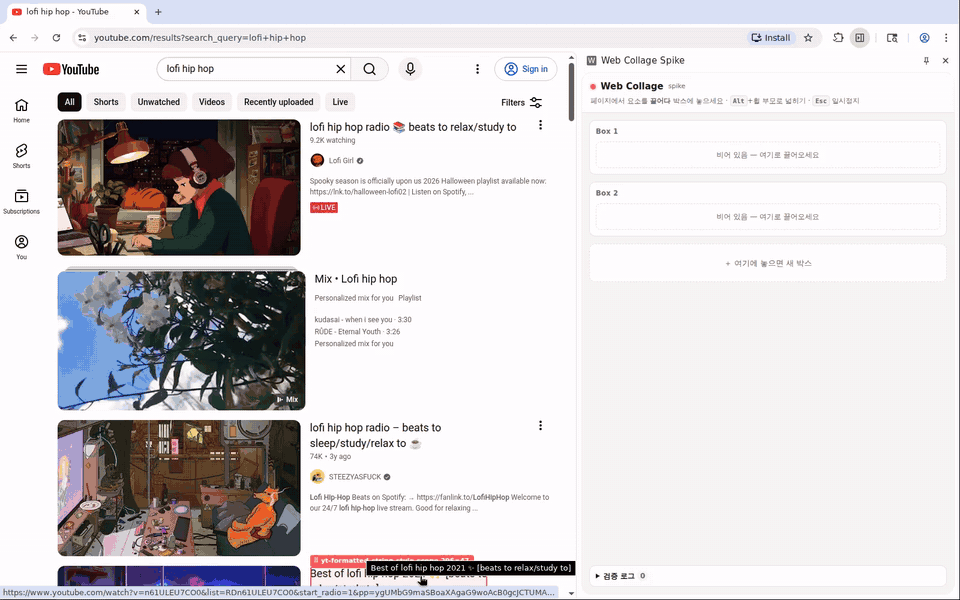
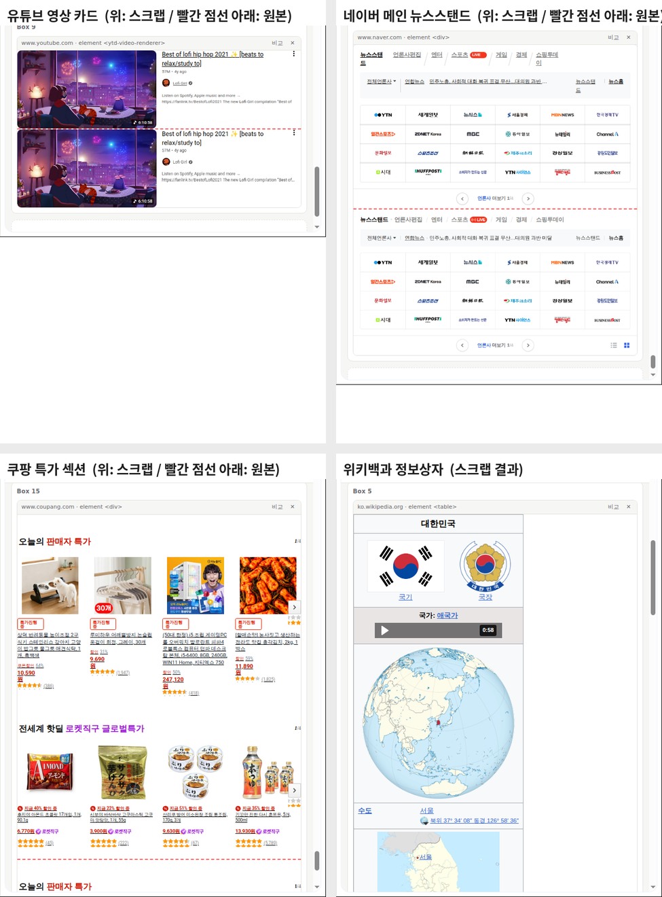

# 기술검증(Spike) 보고서 — 2026-10-07

> **결론: 플랜 A 통과.** 실제 페이지의 요소를 브라우저 기본 드래그로 끌어 크롬 사이드 패널에 놓는 방식이,
> 실제 Chromium에서 **OS 수준의 진짜 마우스 입력**으로 동작했다.
> 실제 사이트 **11곳(13개 케이스)** 중 **10곳에서 끌어 놓기 성공** — 그중 네이버 블로그는 배치가 어긋남(⚠️) — , 1곳(나무위키)은 테스트 환경이 차단돼 미검증.
> 단, **Linux에서만 검증**했다. Windows/Mac은 미검증.
> (채팅에서 한때 "12곳 중 11곳"이라고 셌던 것은 오류. 위 숫자가 맞다.)

## 1. 검증 방법

| 항목 | 내용 |
|---|---|
| 환경 | 클라우드 Linux 컨테이너, 가상 화면 Xvfb 1600×1000, 창 관리자 없음 |
| 브라우저 | Chromium 141.0.7390.37 (헤드리스 아님, 화면에 실제로 그림) |
| 익스텐션 | `--load-extension`으로 [`spike/extension/`](../spike/extension/) 로드 (MV3) |
| 입력 | **xdotool**(XTEST)로 실제 X11 마우스·키 입력 → 크롬이 진짜 OS 드래그 세션을 만듦 |
| 관찰 | CDP(원격 디버깅)로 페이지·패널·service worker 상태 조회, 패널이 결과를 로컬 서버로 전송(`/report`) |
| 테스트 사이트 | [`spike/testsite/`](../spike/testsite/): 부모 선택자·웹폰트·가상요소·SVG 스프라이트, 드래그 방지 사이트, SPA·Shadow DOM·canvas·교차 출처 iframe·폼, 큰 표, 핫링크 보호 이미지 |
| 실제 사이트 | react.dev, 위키백과, MDN, 네이버, 유튜브, Hacker News, GitHub, 네이버 블로그, 브런치, 나무위키, 쿠팡 |

재현 방법은 [`spike/README.md`](../spike/README.md).

## 2. 핵심 질문 결과

| 질문 | 결과 | 근거 |
|---|---|---|
| 페이지 → 사이드 패널로 기본 드래그가 넘어가나? | ✅ | 드래그 이미지(요소 모양)가 커서를 따라 패널로 넘어감 ([middrag.png](assets/middrag.png)) |
| 커스텀 MIME(`application/x-web-collage`)이 도착하나? | ✅ | `dragenter` 시점부터 types에 보이고 `drop`에서 읽힘 |
| 큰 데이터도 넘어가나? | ✅ | text/html 5MB·40MB 그대로 도착 (드롭→표시 13ms·25ms) |
| 박스 안 원하는 위치에 끼워 넣기 | ✅ | 삽입선 표시 + index 계산, 새 박스 영역, 패널 안 순서 바꾸기 |
| 드롭 후 보이기까지 | ✅ | 대부분 **10~70ms**, 일부 100~170ms(이미지가 많거나 요소가 수백 개인 조각). 요소 7천 개짜리 표는 824ms |
| 원본과 같은 모양인가? | ✅ 대체로 | [clip-vs-original.png](assets/clip-vs-original.png) (위: 스크랩, 빨간 점선 아래: 원본 캡처) |
| 드래그 방지 사이트에서도? | ✅ | 페이지의 mousedown/pointerdown/dragstart 차단 스크립트가 **아예 실행되지 못함** |
| 놓은 결과 화면 | ✅ | [afterdrop.png](assets/afterdrop.png) — 웹폰트, `★ NEW` 가상요소 배지, SVG 별 아이콘, 점무늬 배경 유지 |
| 패널 열기 | ✅ | 단축키(Alt+Shift+K, `_execute_action`), 툴바 클릭, 페이지 안 버튼 클릭 → `sidePanel.open()` |

## 3. 로컬 테스트 케이스 (전부 통과)

| ID | 케이스 | 결과 / 메모 |
|---|---|---|
| CORE | 카드(부모 선택자 스타일·웹폰트·`::before` 배지·SVG `<use>`·배경 패턴) → Box 1 | ✅ 스냅샷 13~69ms, 드롭→표시 30~50ms, 폰트·이미지 로컬화 OK |
| E1 | 이미지 단독(기본으로 끌리는 요소) | ✅ 이미지 드래그엔 `Files` 타입이 함께 옴 |
| E2 | 링크 → Box 2 맨 앞에 끼워 넣기 | ✅ |
| E3 | Referer 엄격 검사 이미지(핫링크 차단) | ✅ 패널 직접 로드 0/1 → Referer 재설정 재요청으로 1/1 |
| E4 | 표 전체 → 새 박스 | ✅ |
| E5 | 텍스트 일부: Alt 누른 채 선택 → 끌기 / 선택 후 Alt 떼고 끌기 | ✅ 둘 다 `kind=selection`, 굵게 등 서식 유지 |
| E6 | 복사·드래그 방지 쇼핑몰(카드·이미지) | ✅ 페이지의 `dragstart` 차단 핸들러 실행 0회 |
| E7 | SPA(나중에 JS로 그림) + Shadow DOM(open·closed·slot) + canvas + 교차 출처 iframe + 폼 값 | ✅ canvas → 이미지, iframe → 스크린샷 대체 |
| E8 | **교차 출처 iframe 안쪽** 요소를 직접 끌기 | ✅ (content script `all_frames`) |
| E9 | dataTransfer 5MB / 40MB | ✅ |
| E10 | 패널 안 순서 바꾸기 | ✅ (버그 1건 발견: 아래 G17) |
| E13 | 큰 표 3,250칸(요소 7,102개) | ✅ 스냅샷 3,411ms → 최적화 후 **1,632ms**, 드롭→표시 824ms |
| E14 | `
` 위에서 Alt+휠로 부모(카드)까지 넓힌 뒤 끌기 | ✅ |
| E15 | 패널 닫은 상태에서 페이지 안 버튼으로 열기 | ✅ 사용자 제스처가 content script 메시지로 전달됨 |
| G2·G3 | 편집 영역(contenteditable)은 그냥 끌면 드롭 없음(크롬 동작) → 라벨 손잡이로 끌기 | ✅ 로컬 재현 페이지 `editor.html` (MDN 라이브 예제 상황) |

E11·E12는 결번(검증 중 폐기한 시나리오). 케이스별 자동 합격 기준은 [`TEST_CASES.md`](TEST_CASES.md).

## 4. 실제 사이트 (최종 빌드 기준)

| 사이트 | 끌어온 것 | 결과 | 스냅샷 | 요소 수 | 이미지 | 메모 |
|---|---|---|---|---|---|---|
| react.dev | "You will learn" 박스 | ✅ 원본과 동일 | 36ms | 9 | – | 웹폰트(Optimistic) 로드 |
| react.dev | 코드 에디터 블록 | ✅ | 16ms | 28 | – | |
| 위키백과(ko) | 대한민국 정보상자 | ✅ | 232ms | 388 | 11/11 | |
| MDN | 라이브 코드 예제 | ✅ **손잡이로** | 90ms | 91 | – | 편집 영역이라 일반 드래그 불가(G2), 결과 iframe은 스크린샷 |
| MDN | 속성 표 | ✅ | 25ms | 25 | – | Inter, JetBrains Mono 로드 |
| 네이버 메인 | 뉴스스탠드 | ✅ 거의 동일 | 79ms | 137 | 24/24 | 축소 때문에 탭 글자 줄바꿈 미세 차이 |
| 유튜브 | 검색 결과 영상 카드 | ✅ 거의 동일 | 160ms | 86 | 2/2 | 커스텀 엘리먼트, Roboto 로드 |
| Hacker News | 글 목록 표 | ✅ | 225ms | 754 | – | |
| GitHub | 레포 README | ✅ | 336ms | 350 | – | 최적화 전 1,873ms. 웹폰트 1개 교차 출처로 실패 |
| 네이버 블로그 | iframe 안 글 목록 | ⚠️ | 103ms | 173 | 15/15 | **배치가 오른쪽으로 밀림**(절대 위치 레이아웃) |
| 브런치 | 글 본문 | ✅ | 18ms | 9 | 1/1 | 폰트 로드 |
| 쿠팡 | 특가 섹션 | ✅ | 541ms | 564 | 45/45 | curl은 403인데 실제 브라우저는 통과 |
| 나무위키 | – | ➖ 테스트 불가 | – | – | – | 클라우드 IP가 Cloudflare 보안 확인 화면에 막힘(환경 문제, 익스텐션 문제 아님) |

## 5. 발견해서 고친 함정 (v2에 반드시 반영)

> 형식: 증상 → 원인 → 해결. spike 코드에서 `[G#]` 태그로 검색하면 해당 대응 코드가 나온다(아래 위치표). v2 코드에도 같은 `// [G#]` 태그를 단다.

| ID | 파일 · 위치 |
|---|---|
| G1 | `content.js` mouseover 리스너, `guardDown`(`state.pressed`) |
| G2, G3 | `content.js` `ensureOverlay()`(라벨 손잡이), `beginDrag()`(지연 숨김) |
| G4 | `content.js` mouseover / mousemove(altKey) |
| G5 | `content.js` `holdsSelection()`, `pointInSelection()`, `guardDown` |
| G6, G7 | `content.js` `styleText()`, `propList()` |
| G8, G14, G15 | `content.js` `cloneEl()`, `snapshot()` |
| G9, G18 | `background.js` `clip:begin` 처리, `clips` Map |
| G10, G11 | `content.js` `arm()`, `guardDown`, `beginDrag()` |
| G12, G13, G17 | `sidepanel.js` `onDrop()`, `injectFonts()`, `dropSpot()` |
| G16 | `content.js` 맨 앞 |
| G20, G21 | `content.js` `syncWheel()`, `safeUrl()` / `SKIP_TAGS` |

### 드래그·선택
- **G1. 누르고 움직였는데 드래그 대신 텍스트 선택이 됨**
  원인: 크롬은 버튼을 누르고 몇 px 움직인 **뒤에야** 무엇을 끌지 결정한다. 그 사이 `mouseover`가 무장 대상을 자식 요소로 바꾸면 원래 대상의 `draggable`이 풀려 있다.
  해결: 버튼을 누르고 있는 동안(`state.pressed`) hover/무장 대상을 고정.
- **G2. 코드 에디터 같은 편집 가능 영역(contenteditable)에서는 드래그가 아예 시작되지 않음**
  원인: 크롬은 편집 가능한 텍스트에서 누르면 무조건 텍스트 선택으로 처리한다(조상이 draggable이어도).
  해결: 하이라이트 라벨을 **draggable 손잡이(⠿)**로 만들어, 손잡이를 끌면 현재 하이라이트 대상을 드래그(`beginDrag(..., 'handle')`).
- **G3. 손잡이 드래그가 시작하자마자 취소됨(dropEffect `none`)**
  원인: `dragstart` 안에서 드래그 원본(손잡이)을 `display:none`으로 숨김.
  해결: 손잡이 드래그일 때만 `setTimeout(hideOverlay, 0)`.
- **G4. Alt를 눌렀는데 페이지가 모름**
  원인: 키보드 포커스가 사이드 패널에 있으면 페이지는 keydown을 못 받는다.
  해결: `mouseover`/`mousemove`/`mousedown`의 `e.altKey`로 판단.
- **G5. 선택해 둔 텍스트가 사라져 보이고 끌면 문단 전체가 끌림**
  원인: draggable 요소 안의 텍스트는 크롬이 선택 불가처럼 다룬다(`getSelection().toString()`이 빈 문자열).
  해결: 선택 영역과 겹치는 요소는 무장하지 않음(`holdsSelection`), 선택 영역 위를 누르면 무장 해제(`pointInSelection`).
- **G10. 사이트의 드래그 방지 스크립트**
  해결: content script를 `document_start`에 넣고 `window` capture 단계에서 `pointerdown`/`mousedown`/`dragstart`를 `stopImmediatePropagation`(기본 동작은 막지 않음). 사이트의 `-webkit-user-drag: none`은 인라인 `!important`로 덮음.
- **G11. 링크/이미지 위에서 누르면 크롬이 링크·이미지 드래그로 시작함**
  해결: 무장 대상이 경로에 있으면 우리 드래그로 간주 → `dataTransfer.clearData()` 후 우리 데이터로 채우고 `setDragImage(root)`로 대상 전체 모양을 보여줌.

### 스냅샷
- **G6. Tailwind 사이트에서 없던 3px 테두리가 생김**
  원인: Tailwind는 모든 요소에 `border-style: solid; border-width: 0`. `0px`이 UA 기본값(스타일 none일 때 0)과 같아서 생략했더니 브라우저가 기본 두께(medium=3px)로 그림.
  해결: `border-*-style`이 none이 아니면 `border-*-width`를 항상 함께 기록(outline, column-rule도 동일).
- **G7. GitHub에서 스냅샷이 1.9초**
  원인: CSS 변수가 수천 개라 요소마다 `getComputedStyle().length`가 2,400개 안팎(357개 요소에서 86만 번 읽기). 가상요소 조회는 범인이 아니었다(4ms).
  해결: 깨끗한 문서의 기본 요소에서 뽑은 **실제 CSS 속성 ~380개 목록**만 순회 → 336ms(5.5배).
- **G8. 정지 화면인데 스크롤바가 보임**
  해결: `overflow: auto|scroll` → `hidden`.
- **G9. 원본 비교 스크린샷에 하이라이트 오버레이가 찍힘**
  원인: 오버레이를 숨긴 직후의 프레임이 아직 합성되지 않음.
  해결: `captureVisibleTab` 전에 약 90ms 대기. (참고: `captureVisibleTab`은 초당 2회 제한, 좌표는 최상위 프레임 기준이라 iframe 안 드래그는 스크린샷 대체 미지원)
- **G13. Shadow DOM 안 `@font-face`는 크롬에서 무시됨** → 패널 문서 head에 주입.
- **G14. closed Shadow DOM** → content script 전용 API `chrome.dom.openOrClosedShadowRoot(el)`로 펼침. `<slot>`은 `assignedNodes({flatten:true})`로 치환.
- **G15. 커스텀 엘리먼트 복제 시 페이지 코드가 실행될 위험** → 복제본은 `document.implementation.createHTMLDocument('')`(비활성 문서)에서 생성.
- **G16. UA 기본값 계산용 숨김 iframe 안에서도 content script가 돈다**(`match_about_blank`) → `data-wc-defaults` 프레임이면 즉시 종료.
- 루트 보정: 떼어낸 루트는 `position: relative`, margin 0, transform·float 제거. `position: fixed` 자손은 `absolute`로, `sticky`는 `relative`로.
- 블록 요소는 `width` 고정 + 높이는 `min-height`(글꼴 차이로 내용이 길어져도 잘리지 않게), 대체 요소(img·svg·video·canvas·input…)는 width/height 고정.

### 패널·플랫폼
- **G12.** 이미지 드래그엔 `Files` 타입이 붙어 온다(원본 이미지 파일을 바로 쓸 수도 있음).
- **G17. (미수정 버그)** 패널 상단 고정 헤더 위에 놓으면 마지막 박스로 들어감. 긴 패널은 드래그 중 **자동 스크롤**이 없어 먼 위치로 못 옮김.
- **G18. (미수정)** MV3 service worker가 잠들면 메모리의 조각 보관소가 사라짐 → `storage.session`/IndexedDB로 영속화 필요.
- **G19.** 페이지 전체가 iframe인 사이트(네이버 블로그)도 `all_frames` 덕분에 iframe 안에서 바로 동작.

### 계획서 검수(별도 AI 리뷰)에서 발견해 spike 에서 고친 것
- **G20. 스크랩 모드가 꺼져 있어도 모든 페이지의 스크롤이 느려질 수 있었음**
  원인: `window`에 `wheel` 리스너를 `passive:false`로 상시 등록 → 크롬이 휠 스크롤마다 메인 스레드를 기다림.
  해결: 스크랩 모드일 때만 등록/해제(`syncWheel()`).
- **G21. `javascript:` URL 필터 우회 가능**
  원인: 절대화 **전에** 문자열로 검사 → `jav\tascript:`(탭 포함)는 검사를 통과하고, URL 파서가 탭을 지워 `javascript:`가 됨. SVG `<set>/<animate>`로 href 를 바꾸는 우회도 가능.
  해결: 정규화한 뒤 프로토콜로 판단(`safeUrl()`: href 는 http(s)만, src 는 http(s)+`data:image/*`만), SVG 애니메이션 요소는 복제하지 않음.

### v2 에서 발견·수정 (2026-10-07)
- **G17 수정**: 패널 고정 헤더 위에선 드롭을 받지 않고(`dropEffect='none'`), 박스 밖 보드 빈 곳은 최상위에 넣는다. 드래그 중 패널 위·아래 가장자리 56px 안에 있으면 자동 스크롤(`dragover` 는 마우스가 멈춰 있어도 계속 온다). E2E `G17_header_drop_ignored`, `M2c_autoscroll`.
- **G18 수정**: 완성된 조각을 IndexedDB `clipStore` 에 보관(10분 뒤 정리). 메모리는 기다리는 쪽과 화면 캡처 Promise 용.
- **G22. `clip:current` 폴백이 가끔 "외부 드롭"이 됨**
  원인: drop(패널 프로세스)과 dragend(원본 탭 프로세스)는 서로 다른 프로세스에서 background 로 메시지가 가서, 패널의 `clip:current` 질의보다 원본의 `clip:end` 가 먼저 도착할 수 있다(CDP 모드에서 재현).
  해결: 방금(1.5초 안에) 끝난 드래그도 진행 중으로 본다(`src/bg/clip-store.ts` `currentClip`).
- **G23. 블록 머리 작은 버튼 위에 놓으면 드롭이 안 됨** (v2 초안의 자체 버그)
  원인: 버튼 위 드롭을 거부하도록 해 둠. 사람은 그렇게 정확히 조준하지 않는다. 해결: 헤더(.top)·검증 로그만 제외.

### 검수에서 나온 리스크 (아직 미해결 → PLAN 해당 마일스톤)
| ID | 내용 | 마일스톤 |
|---|---|---|
| R3 | 패널이 열려 있는 동안 무장된 요소의 mousedown·click 을 막아 **링크·버튼·메뉴가 동작하지 않음**. 게다가 `scrapEnabled`가 `storage.local` 하나라서 **패널이 없는 다른 창까지** 스크랩 모드가 됨 | M2 (Q9) |
| R4 | 설치·업데이트 직후 **이미 열려 있던 탭엔 content script 가 없음**(새로고침 필요), 업데이트 후 남은 옛 스크립트(고아)가 리스너를 유지, service worker 가 죽으면 패널 포트가 재연결 안 됨 | M0 안내 / M2 |
| R6 | 드래그 중(버튼 누른 상태)에 스냅샷을 떠서 **`:hover`·`:active` 스타일이 박제**될 수 있음(카드 떠오름, 링크 밑줄). refShot 도 같은 상태라 픽셀 비교로는 안 잡힘 | M1 |
| R7 | 이미지 받기가 `credentials:'omit'` → **로그인해야 보이는 이미지**(카페·메일·사내)는 로컬화 실패 가능. Referer 규칙은 host 단위라 그동안 같은 host 의 다른 비탭 요청에도 적용, 규칙 id 카운터가 SW 재시작 시 1000으로 돌아가 충돌 가능 | M1·M3 |
| R8 | `dragstart` 안에서 대상 전체의 `innerText`·`outerHTML`을 동기로 만들어 **큰 요소는 드래그 시작이 늦어질 수 있음** | M0/M1 |
| R9 | 이미지 드래그엔 `Files`가 남아서(`clearData`로 안 지워짐) Gmail·Drive 같은 **업로드 드롭존이 반응**할 수 있음 | M1 |
| R11 | Windows: Alt 단독 입력은 크롬 메뉴로 포커스를 옮길 수 있고, **Alt+Shift 는 입력 언어 전환** 단축키일 수 있음 → Alt+휠·Alt 드래그·Alt+Shift+K 실물 확인 필요 | M0(소유자) |
| R12 | 스냅샷을 시간 조각으로 나누면(M1) 그 사이 DOM 이 바뀌어(캐러셀·SPA) **찢어진 조각**이 될 수 있음 → 변경 감지·재시도 | M1 |

## 5-1. Windows 결과 (v2 빌드, 2026-10-07) — PLAN S5 / M0 ✅ 항목

> **결론: Windows 11 에서도 플랜 A 동작.** 진짜 OS 마우스 입력(SendInput)으로 페이지 → 사이드 패널 드래그가 넘어가고, **번호표(커스텀 MIME)가 매번 도착**했다.
> 환경: Windows 11 Pro 10.0.26200, 배율 100%, **Chrome for Testing 155.0.8059.39**(정식 Chrome 137+ 는 `--load-extension` 을 무시해서), v2 E2E 빌드, `e2e/` 하네스 OS 모드.

| 케이스 | 번호표 | kind / tag | 스냅샷 | 드롭→표시 |
|---|---|---|---|---|
| CORE 카드 | ✅ | element / article | 18ms | 50ms |
| E1 이미지 | ✅ | element / img | 6ms | 9ms |
| E2 링크 | ✅ | element / a | 2ms | 25ms |
| E3 Referer 검사 이미지 | ✅ | element / img (Referer 재시도 성공) | 1ms | 7ms |
| E4 표 → 새 박스 | ✅ | element / table | 8ms | 8ms |
| E14 Alt+휠로 부모 넓히기 | ✅ | element / article | 8ms | 10ms |
| G2 편집 영역 직접 끌기 | — | (드롭 없음 = 크롬 동작 그대로) | | |
| G2·G3 라벨 손잡이 | ✅ | element / section, via=handle | 9ms | 19ms |
| E5a Alt 누른 채 선택 → 끌기 | ✅ | selection / p | 8ms | 9ms |
| E5b 선택 후 Alt 떼고 끌기 | ✅ | selection / p | 1ms | 8ms |
| 선택 없을 때 요소 드래그 회귀 | ✅ | element / article | 9ms | 7ms |

- **R11(Windows Alt)**: Alt+휠, Alt+드래그 선택 모두 정상. Alt 를 눌렀다 떼도 페이지 쪽 동작이 깨지지 않았다.
- **아직 미확인**: Alt+Shift+K 단축키(입력 언어 전환과 겹치는지 — 하네스는 일부러 안 씀), 소유자 PC 의 **정식 Chrome**(웹스토어/압축해제 로드), Mac.
- 나머지 케이스(E6~E10, E13, E15, F1, G17, M2a~e, P1~P4 — 총 42개)는 CDP 모드로 전부 통과 (D19).

## 6. 알려진 한계 (M1~M2에서 해결)

| 한계 | 예 | 방향 |
|---|---|---|
| 절대 위치로 배치된 레이아웃이 어긋남 | 네이버 블로그 목록 | 포함 블록이 루트 밖인 absolute 자손 좌표를 루트 기준으로 재계산 |
| 일부 웹폰트 교차 출처 실패 | GitHub | background가 폰트 파일을 받아 data URL로, family 이름 접두어로 충돌 방지 |
| 화면 밖 영상·iframe 대체 이미지 없음 | GitHub README 영상 | iframe은 그 프레임의 content script에게 스냅샷 요청, 영상은 poster/현재 프레임 |
| 큰 덩어리 느림 | 요소 7천 개 1.6초 | 분할 처리(yield), 캐시, 상한 초과 시 스크린샷 조각 |
| 좁은 패널에서 축소 시 글씨가 작음 | 텍스트 조각 | "맞춤 / 원본 크기 / 다시 흐르게" 옵션 |
| 조상 배경이 빠짐 | 카드 안 문단만 떼면 배경 패턴 없음 | 투명 루트는 가장 가까운 불투명 조상 배경을 옵션으로 포함 |
| Windows/Mac 미검증 | – | M0에서 소유자가 실물 확인, 커스텀 MIME 미도착 대비 폴백 |

## 7. 측정값에 대해
- 같은 케이스도 실행마다 수 ms~수십 % 차이가 난다(예: E9 드롭→표시 13~38ms, E13 666~824ms). 표의 숫자는 대표값이며, 합격 판정은 [`TEST_CASES.md`](TEST_CASES.md)의 기준으로 한다.

## 8. 환경 메모
- 컨테이너의 외부망은 프록시를 거쳤다(`--proxy-server=$HTTPS_PROXY`, 프록시 CA는 NSS 저장소에 미리 등록됨). 코드탭 환경의 네트워크 설정에 따라 실제 사이트 테스트가 막힐 수 있다 → 로컬 테스트 사이트 위주로 회귀 테스트.
- 회사 PC에서는 검증하지 않았다(소유자 요청).
